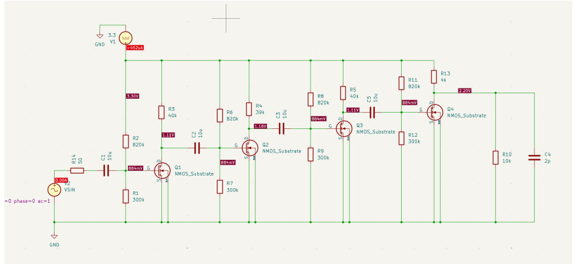
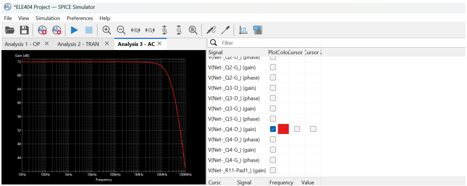
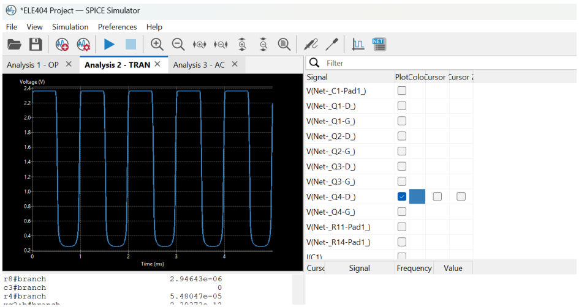

**Report (PDF):** [MOSFET_Amplifier_Report.pdf](docs/MOSFET_Amplifier_Report.pdf)

# Four-Stage CMOS Voltage Amplifier (KiCad SPICE)

A four-stage common-source MOSFET amplifier designed by hand calculation and verified in KiCad SPICE. Built for ELE404 at Toronto Metropolitan University using the GlobalFoundries 180 nm CMOS process parameters and a single 3.3 V supply.

## Design Targets

- Total gain above 60 dB
- Bandwidth of at least 500 kHz
- Gain per stage at most 40 dB
- Load of 10 kΩ with less than 10% gain loss
- Output swing above 1.5 Vpp

## What's inside

- **Bias design:** I_D = 50 µA, V_OV = 0.254 V, W/L = 15.5 µm / 1 µm
- **Resistor divider biasing:** 820 kΩ / 300 kΩ for V_GS ≈ 0.884 V
- **Small-signal analysis:** g_m, r_o, and per-stage gain
- **Simulations:** DC operating point, AC sweep, transient

## Project Structure

- `kicad/` → KiCad project and schematic
- `images/` → schematic and simulation screenshots
- `docs/` → full design report PDF

## Results

| Parameter | Spec | Calculated | Simulated |
|---|---|---|---|
| Total gain | ≥ 60 dB | 69 dB | ~70-72 dB |
| -3 dB bandwidth | ≥ 500 kHz | ~27.8 MHz | ~15 MHz |
| Gain per stage | ≤ 40 dB | 23 dB | 24 dB |
| Output swing | ≥ 1.5 Vpp | n/a | ~2.3 Vpp |

**Known limitation:** DC power came out around 1.5 mW against a 1 mW target. Every fix I tried traded off another spec, so I prioritized gain and bandwidth.

### Schematic

### AC Analysis

### Transient Analysis

## How to Open

1. Install KiCad
2. Open the project file in `kicad/`
3. Run the Simulator and select the OP, AC, or Transient analysis

## Tools Used

- KiCad (SPICE simulator)
- GlobalFoundries 180 nm CMOS parameters
